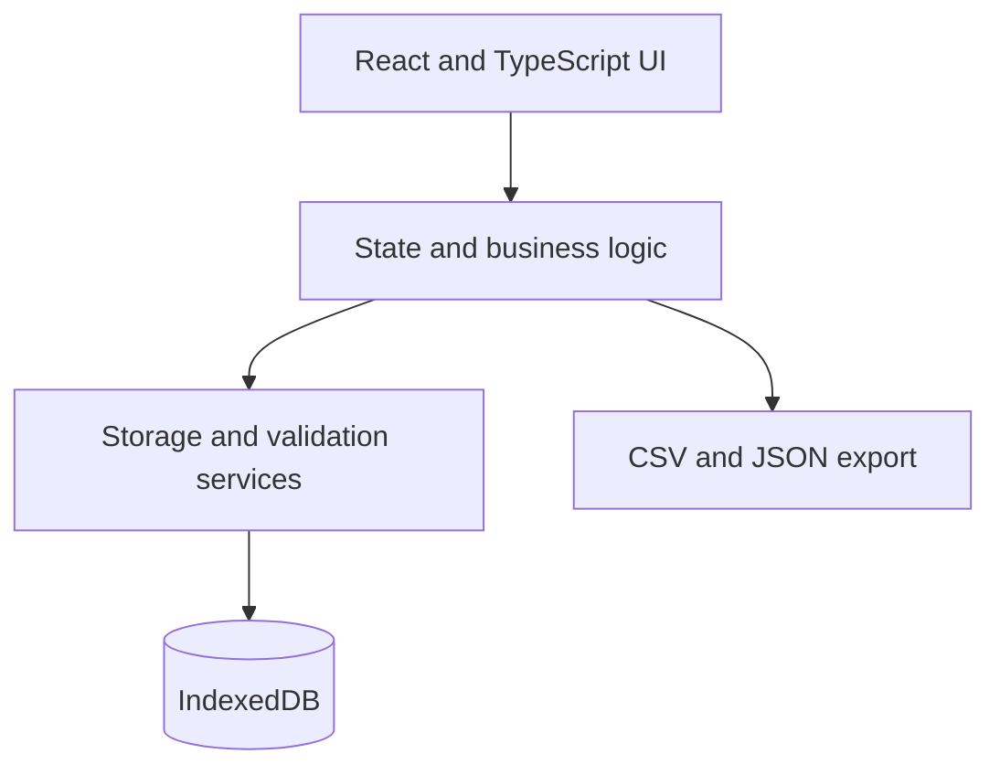

# MoneyPilot

**Local-first personal finance management — no account required.**


[Full French documentation](README_FR.md)

## Overview

MoneyPilot is a student engineering portfolio project that makes everyday budgeting accessible without a cloud account. It combines financial tracking, multi-month planning and portable data exports in a responsive web application.

**Current status:** V1, available to run locally. A hosted public demo is not yet available.

## Features

| Module | Capabilities |
| --- | --- |
| Dashboard | Estimated balance, monthly cash flow and charts |
| Transactions | Income and expense tracking, search and filtering |
| Budgets | Monthly limits and category-level monitoring |
| Multi-month planning | Funding allocation, reserved expenses, adjustments and reserves |
| Recurring expenses | Due dates and explicit payment confirmation |
| Data portability | JSON backup and restore; CSV export for analysis |
| Demo mode | Isolated sample data at `/demo` |
| Offline support | Production service worker and installable web app foundations |

## Preview

<p align="center">
  
</p>

## Architecture



The application separates presentation, domain calculations and persistence. Monetary calculations use integer cents; planned budget allocations are distinct from actual transactions.

## Technology stack

React 19 · TypeScript · Vite · Tailwind CSS · React Router · Lucide React · IndexedDB · Service Worker · Node.js test runner

## Getting started

Use Node.js 20.19+ or 22.12+ compatible with the locked dependencies, preferably a maintained LTS release.

```bash
git clone https://github.com/charafeddine-uw/MoneyPilot.git
cd MoneyPilot
npm ci
npm run dev -- --host 127.0.0.1 --port 5173 --strictPort
```

Open [MoneyPilot](http://127.0.0.1:5173) or [demo mode](http://127.0.0.1:5173/demo) to explore fictional transactions without entering personal information.

### Production build

```bash
npm run build
npm run preview -- --host 127.0.0.1 --port 4173 --strictPort
```

Offline functionality requires the production build and a secure context (HTTPS or localhost). Wait for the offline-ready indication in Settings. Development and preview URLs have separate browser storage.

## Testing and quality

The existing project documentation reports 69 automated tests, including scenarios for financial calculations, persistence, backup validation and offline resources.

```bash
npm test
npm run typecheck
npm run build
npm run check:publication
```

See the [test plan](docs/TEST_PLAN.md) for coverage and validation limits.

## Data analysis with Python

CSV exports can be explored with Pandas. For example:

```python
import pandas as pd

transactions = pd.read_csv(
    "export-local.csv", sep=";", decimal=",", encoding="utf-8-sig"
)
print(transactions.head())
print(transactions.describe(include="all"))
```

This is an external analysis example, not a built-in Python or AI feature.

## Privacy and limitations

- Financial records stay in the current browser profile; no bank integration, authentication or cloud synchronization is provided.
- Application-level encryption is not implemented. Keep regular JSON backups; restoring replaces existing records rather than merging them.
- The current release supports one primary EUR account. Its calculated balance is not a bank statement.
- Physical mobile installation and airplane-mode operation still need validation.
- Never commit real financial records, backups or private screenshots.

## Documentation

- [Full French documentation](README_FR.md)
- [Technical architecture](docs/ARCHITECTURE.md)
- [Multi-month budgeting](docs/BUDGET_LONGUE_DUREE.md)
- [Testing and validation](docs/TEST_PLAN.md)
- [Publication guide](docs/PUBLICATION.md)
- [GitHub delivery guide](docs/LIVRAISON_GITHUB.md)

## Roadmap

Potential future work, not implemented in V1:

- [ ] Publish an online demonstration and validate installation on physical iOS and Android devices.
- [ ] Savings and financial goals.
- [ ] Spending analytics and forecasting.
- [ ] Python-based exploratory analysis of sample financial data.

## Author

Developed by [charafeddine-uw](https://github.com/charafeddine-uw) as an engineering student portfolio project, combining software engineering, financial data handling and an interest in Data & AI.

## License

No reuse license has been selected yet.
