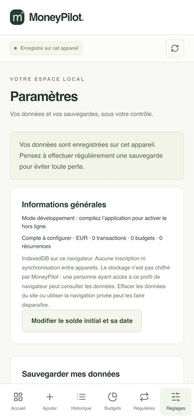

# MoneyPilot

**Une application personnelle de gestion de budget, locale et sans inscription.**

MoneyPilot est un projet de portfolio étudiant développé avec React et TypeScript. Il permet de saisir ses revenus et dépenses, de suivre un solde estimé et des budgets mensuels, puis de sauvegarder ses données sans dépendre d’un compte utilisateur ou d’un service cloud.

La V1 est une application fonctionnelle en local. Elle ne se connecte à aucune banque et ne prétend pas remplacer un relevé bancaire. Aucune démonstration publique n’est actuellement déployée.

## Fonctionnalités

| Domaine | Fonctionnement disponible |
| --- | --- |
| Tableau de bord | Solde estimé, revenus, dépenses, résultat mensuel, graphiques et transactions récentes |
| Transactions | Ajout, modification, suppression logique, recherche, filtres par date/type/catégorie et tri chronologique |
| Budgets | Budget mensuel global et par catégorie, suivi de consommation et indication des dépassements |
| Budget longue durée | Financement attendu/reçu, charges réservées, répartition au jour près, ajustements mensuels, surplus, imprévus et archives |
| Dépenses récurrentes | Création, modification, désactivation, suivi des échéances et confirmation explicite d’une dépense |
| Configuration | Un compte principal en euros, solde initial, date de référence et gestion des catégories |
| Sauvegardes | Export JSON complet, validation et aperçu avant restauration avec remplacement contrôlé |
| Analyse | Export CSV de toutes les transactions ou de la sélection de l’historique |
| Démonstration | Parcours `/demo` avec données fictives en mémoire, séparé des données personnelles |
| Interface | Navigation latérale sur ordinateur et navigation inférieure sur mobile |
| Hors ligne | Manifest, icônes et précache des ressources du build de production |

Les dépenses récurrentes prévues ne modifient pas le solde tant qu’elles ne sont pas confirmées. Une confirmation rejouée ne crée pas de doublon pour la même échéance.

## Captures d’écran

Capture de l’interface locale, sans donnée financière personnelle :



D’autres captures pourront être ajoutées : tableau de bord, historique et budgets. Utiliser uniquement le mode `/demo` et vérifier l’absence d’adresse e-mail, de nom de compte personnel et de données réelles. Les nouvelles images sont ignorées par défaut : seules les captures explicitement relues sont autorisées dans le dépôt.

## Budget longue durée

La rubrique **Budget longue durée** convient notamment à une bourse couvrant plusieurs mois. Un seul budget peut être actif ; les archives n’ont pas de limite de nombre définie par l’application, sous réserve de la capacité de stockage du navigateur.

- Lier tout ou partie d’un revenu déjà enregistré, ou demander explicitement la création d’un nouveau revenu à la création du budget. Une somme attendue reste une prévision, sans effet sur le solde.
- Réserver les charges récurrentes sélectionnées et une réserve de sécurité, puis répartir le reste proportionnellement aux jours couverts dans chaque mois, bornes incluses. Les centimes sont répartis exactement.
- Personnaliser les montants mensuels sans dépasser les fonds réellement affectés, et laisser une part non affectée. Les choix sont conservés lors des recalculs.
- Réconcilier les paiements fixes par identifiant de récurrence/échéance, ou par un rapprochement manuel explicite. Les écarts de paiement modifient la projection, sans seconde dépense.
- Répartir automatiquement les dépassements sur les mois suivants, selon leurs allocations restantes. Afficher la part non couverte lorsque ces mois ne suffisent pas.
- Choisir le sort d’un surplus après la fin du mois : mois suivant, réserve ou partage. Sans choix, il reste en attente. Utiliser la réserve et/ou les mois futurs pour une dépense imprévue existante.
- Consulter le rythme de consommation et un repère quotidien indicatif. Les dépenses réelles ne sont jamais bloquées par une enveloppe.

Les réglages de période et les prévisions récurrentes choisies à la création sont conservés ; les modifications ultérieures des modèles de récurrence ne sont pas appliquées silencieusement à cette copie. Les paiements réels identifiés restent pris en compte. La fin de période entraîne une clôture au prochain chargement ou rafraîchissement : le bilan repose sur un instantané figé, indiqué comme tel. Les archives sont consultables, sans création automatique d’un nouveau budget.

Une répartition, un surplus ou une décision de réserve ne déplace pas d’argent et ne crée aucun revenu/dépense. Ce module utilise le même historique que les autres pages, sans l’additionner une seconde fois. Les nouveaux revenus restent séparés tant qu’un choix d’affectation n’est pas enregistré.

## Stack technique

- React 19 et TypeScript en mode strict.
- Vite pour le développement et la compilation.
- Tailwind CSS et CSS pour la présentation.
- React Router pour la navigation et Lucide React pour les icônes.
- IndexedDB native pour la persistance ; aucune bibliothèque de stockage supplémentaire à l’exécution.
- Tests avec le module `node:test` et `fake-indexeddb` pour les scénarios de stockage.

Le projet n’utilise ni backend applicatif, ni authentification, ni accès bancaire, ni synchronisation cloud. Aucune variable d’environnement ou clé API n’est requise.

## Installation et lancement

Prérequis : Node.js compatible avec les dépendances verrouillées — Node 20.19+ ou Node 22.12+ — et npm. Utiliser de préférence une version LTS encore maintenue.

1. Télécharger le dépôt puis extraire l’archive, ou le cloner depuis GitHub.
2. Ouvrir un terminal à la racine du projet, là où se trouve `package.json`.
3. Installer et démarrer :

```sh
npm ci
npm run dev -- --host 127.0.0.1 --port 5173 --strictPort
```

Ouvrir **http://127.0.0.1:5173** et garder le terminal ouvert. Au premier lancement, définir le solde et sa date de référence. Les visites suivantes ouvrent directement l’accueil. Pour explorer les exemples fictifs : **http://127.0.0.1:5173/demo**.

`Ctrl+C` arrête le serveur. Ne pas ouvrir directement `index.html` depuis l’explorateur de fichiers : l’application doit d’abord être servie en HTTP/HTTPS.

## Build et PWA

```sh
npm run build
npm run preview -- --host 127.0.0.1 --port 4173 --strictPort
```

Ouvrir **http://127.0.0.1:4173**, puis Paramètres. Attendre le message **« Ressources hors ligne prêtes »** avant de tester sans réseau. Le service worker précache les fichiers statiques JS/CSS, le manifest et les icônes ; les données financières restent dans IndexedDB, jamais dans un cache de réponses réseau.

Le service worker est désactivé en développement. Il nécessite un contexte sécurisé, comme HTTPS ou localhost. Une mise à jour attend la fermeture des anciens onglets pour éviter de mélanger deux versions.

Attention : le port 4173 et le port 5173 correspondent à des stockages distincts. Conserver la même adresse pour un usage régulier, ou utiliser un export/import JSON pour changer d’origine.

Sur un téléphone, `127.0.0.1` désigne le téléphone lui-même. Le dépôt seul ne fournit pas d’URL mobile : il faut organiser un accès initial au build sur une origine HTTPS adaptée. L’installation et le mode avion sur téléphone physique restent à valider.

## Où sont les données ?

Les données sont enregistrées dans le navigateur de l’appareil utilisé, dans la base IndexedDB `moneypilot-local-v1`. Elles ne sont ni enregistrées dans les fichiers du dépôt, ni transmises à un service financier extérieur.

Un document structuré regroupe compte, catégories, transactions, budgets, récurrences, préférences et numéro de révision. Les écritures attendent la confirmation de la transaction IndexedDB. Les restaurations et confirmations de récurrences sont atomiques. Les conflits entre onglets sont détectés afin d’éviter une modification fondée sur un état périmé.

Pour une V1 personnelle, ce choix réduit la complexité et rend les remplacements complets faciles à raisonner. En contrepartie, le document est relu et validé à chaque écriture ; le projet n’est pas conçu ni mesuré pour de très gros volumes.

### Sauvegarder

**Paramètres → Télécharger la sauvegarde JSON**. Vérifier que le téléchargement est terminé et conserver le fichier sur un support approprié. La date affichée indique un téléchargement déclenché ou la date d’une sauvegarde restaurée ; le navigateur ne peut pas certifier que le fichier a été conservé.

### Restaurer ou changer d’appareil

1. Ouvrir MoneyPilot sur l’appareil de destination.
2. Aller dans **Paramètres → Restaurer une sauvegarde** et sélectionner le JSON.
3. Vérifier le résumé du fichier validé.
4. Télécharger et conserver une sauvegarde des données actuelles.
5. Cocher la confirmation puis confirmer le remplacement.

La restauration remplace l’ensemble des données de cette installation : ce n’est pas une fusion. Un format incompatible, un montant invalide, une relation incohérente, un doublon ou un conflit de révision bloque l’opération. La limite d’import est de 20 Mo. Les exports utilisent désormais le format 2, qui inclut les budgets longue durée ; les sauvegardes précédentes au format 1 restent importables. Le format 2 ne peut pas être ouvert par une ancienne version de l’application qui ne le connaît pas.

Le CSV sert à l’analyse, pas à la restauration complète. Il utilise UTF-8 avec BOM, le séparateur `;`, la virgule décimale et des champs entre guillemets. Les cellules susceptibles de devenir des formules sont neutralisées. Exemple de lecture avec Pandas :

```python
import pandas as pd
transactions = pd.read_csv("export-local.csv", sep=";", decimal=",", encoding="utf-8-sig")
```

## Règles financières

- Les montants sont enregistrés en **centimes entiers**.
- Le solde initial représente le montant disponible **à la fin de la date de référence**.
- Seules les opérations strictement postérieures à cette date modifient le solde estimé.
- Les totaux mensuels incluent les opérations du mois, y compris celles déjà comprises dans le solde initial.
- Les budgets servent au suivi ; ils ne constituent pas des transactions supplémentaires.
- Les transferts entre comptes et les remboursements avec compensation ne sont pas modélisés dans cette version.

## Organisation du code

```text
src/
├── components/       composants partagés et graphiques SVG
├── layouts/          navigation adaptative
├── pages/            écrans financiers et paramètres
├── providers/        état React et orchestration des opérations
├── services/         IndexedDB, validation des sauvegardes et repository
├── lib/              calculs, CSV, téléchargement, PWA et démonstration
├── types/            types métier
└── legacy/           code V0 préservé, dont les calculs testés
public/               manifest, icônes et service worker
scripts/              génération du précache et contrôle de publication
tests/                tests de calculs, stockage, PWA et publication
docs/                 architecture, tests, publication et captures approuvées
.githooks/            contrôle facultatif avant commit, à activer localement
```

Les pages utilisent une couche de stockage séparée : les calculs et l’interface n’ont pas besoin de connaître les détails IndexedDB. Le code V0 est conservé pour les tests historiques ; sa règle de référence diffère de celle de la V1 et il n’est pas utilisé par les pages actuelles.

## Vérifications

```sh
npm test
npm run typecheck
npm run build
npm run check:publication
```

La suite comporte 69 tests automatisés, dont 31 scénarios du module longue durée et de sa migration. Les tests couvrent notamment les centimes, changements de mois, budgets, récurrences, persistance, erreurs et annulation de transactions, restauration JSON, conflits, export CSV, manifest et lecture du précache. Le build vérifie aussi la syntaxe du service worker généré.

Des essais navigateur ont été réalisés avec données fictives : rechargement, fermeture/réouverture d’onglet, modification, sauvegarde/restauration et utilisation dans Chrome avec le serveur arrêté. Un écran de 390 × 844 a été contrôlé. Le plan et les limites des essais sont décrits dans [docs/TEST_PLAN.md](docs/TEST_PLAN.md).

## Confidentialité et limites

- **Pas de chiffrement applicatif** : une personne utilisant le même profil de navigateur peut accéder aux données.
- Effacer les données du site, utiliser la navigation privée, subir une éviction du navigateur ou une panne peut entraîner une perte. Les sauvegardes restent indispensables.
- Un changement d’appareil, de navigateur, de profil, d’hôte ou de port ne synchronise pas les données.
- Un seul compte principal en euros est exposé dans la V1.
- Pas de connexion bancaire, authentification, synchronisation, module d’épargne ou objectifs financiers. Les projections disponibles restent limitées au budget longue durée et aux charges récurrentes sélectionnées.
- Installation sur un téléphone physique, redémarrage complet de l’ordinateur et pression disque réelle non testés. Les essais automatisés de stockage utilisent une simulation IndexedDB, complétée par les essais navigateur décrits ci-dessus.

## Préparer une contribution ou une publication

Ne jamais ajouter de sauvegarde financière, export CSV, configuration locale, document personnel ou capture de données réelles. Le `.gitignore` ignore ces formats par défaut et `npm run check:publication` contrôle les fichiers proposés ou suivis par Git. Pour activer le contrôle des fichiers placés dans l’index, après initialisation ou clonage du dépôt :

```sh
git config --local core.hooksPath .githooks
```

Un hook local et un `.gitignore` ne garantissent pas l’absence de fuite : ils peuvent être contournés. Relire les fichiers et l’historique avant tout push. Voir le [guide de publication](docs/PUBLICATION.md).

## Pistes d’évolution

Après validation de la V1 : tester l’installation sur appareils iOS/Android réels, puis étudier l’épargne, les objectifs financiers et les prévisions. Ces modules ne sont pas développés. Les futurs transferts devront rester distincts des revenus et dépenses.

## Licence

Aucune licence de réutilisation n’est encore définie pour ce projet. Ce choix reste à faire par son auteur avant d’en annoncer une.
